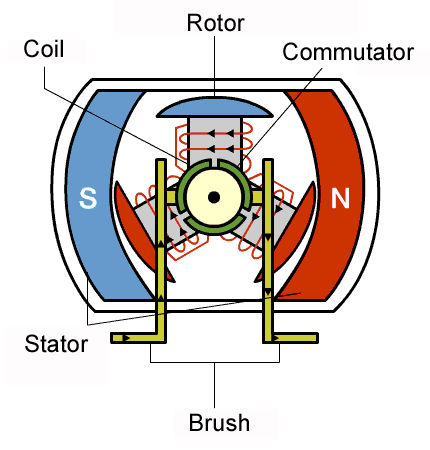

Pour contrôler efficacement un moteur électrique, il faut d’abord comprendre sa structure mécanique. Bien qu'il existe une immense variété de moteurs, le monde du Motor Control haute performance tourne principalement autour de deux technologies : le moteur **BLDC** (_Brushless DC_) et le moteur **PMSM** (_Permanent Magnet Synchronous Motor_).

D’un point de vue purement anatomique, ces deux moteurs sont presque jumeaux. Ils partagent la même architecture de base, composée de deux éléments principaux : le **stator** (la partie fixe) et le **rotor** (la partie tournante).

/
