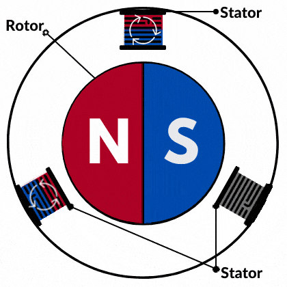
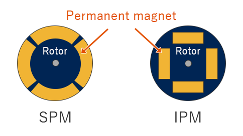

  

    
  

  

    Pour contrôler efficacement un moteur électrique, il faut d’abord comprendre sa structure mécanique. Bien qu'il existe une immense variété de moteurs, le monde du Motor Control haute performance tourne principalement autour de deux technologies : le moteur BLDC (Brushless DC) et le moteur PMSM (Permanent Magnet Synchronous Motor).
  

  

    D'un point de vue purement anatomique, ces deux moteurs sont presque jumeaux. Ils partagent la même architecture de base, composée de deux éléments principaux : le stator (la partie fixe) et le rotor (la partie tournante).
  

# Le stator : le générateur de champ

Le stator est la carcasse extérieure cylindrique du moteur. Il ne bouge pas, mais c'est lui qui dicte le mouvement en générant un champ magnétique tournant grâce à l'énergie électrique qu'on lui fournit.

C'est ici, dans la manière dont le cuivre est enroulé, que réside la seule vraie différence physique entre un BLDC et un PMSM :

- **Dans un BLDC :** Le bobinage est dit **concentré**. Les bobines sont enroulées de façon très géométrique. Cette construction force la Force Électromotrice (Back-EMF) à prendre une forme **trapézoïdale**.
- **Dans un PMSM :** Le bobinage est dit **distribué**. Les fils d'une même phase sont répartis de manière plus fluide et croisée dans les encoches du stator. Cette subtilité physique lisse le comportement du moteur et génère une Back-EMF parfaitement **sinusoïdale**.

# Le rotor : la source de flux

<Columns cols={2}>
  <Column>
    Le rotor est la partie centrale mobile, solidarisée à l'arbre du moteur qui transmet la puissance mécanique (le couple). Le flux magnétique du rotor est généré uniquement par des aimants permanents.

    En examinant la coupe transversale d'un moteur, on distingue deux architectures majeures pour le rotor : SPM et IPM.
  </Column>
  <Column>
    
  </Column>
</Columns>

## Les aimants en surface : SPM (Surface Permanent Magnet)

Les aimants sont collés directement sur la surface extérieure du cylindre du rotor.

- **Comportement :** Les aimants "font face" directement au stator. L'inductance de l'axe $$d$$ (direct) est strictement égale à l'inductance de l'axe $$q$$ (quadrature) : $$L_d = L_q$$.
- **Conséquence FOC :** Le moteur n'a pas de couple de réluctance. Pour le piloter de manière optimale sous sa vitesse nominale, on fixe simplement la consigne de courant $$I_d = 0$$.

## Les aimants insérés : IPM (Interior Permanent Magnet)

Les aimants sont glissés à l'intérieur même de la structure en acier du rotor, souvent disposés en forme de "V" ou de fentes rectangulaires.

- **Comportement :** L'acier du rotor entoure les aimants. Comme l'acier conduit le flux magnétique bien mieux que l'aimant lui-même, la géométrie magnétique change selon l'angle. L'inductance de l'axe $$q$$ devient supérieure à celle de l'axe $$d$$ ($$L_q > L_d$$). On dit que le moteur a une saillance magnétique.
- **Conséquence FOC :** Ce moteur génère un couple supplémentaire appelé **couple de réluctance** (l'acier du rotor cherche naturellement à s'aligner avec le champ du stator). Pour exploiter 100% de ce moteur, l'algorithme $$I_d = 0$$ ne suffit plus : il faut utiliser l'algorithme **MTPA** (Maximum Torque Per Ampere) pour injecter un $$I_d$$ négatif et gratter ce couple gratuit.
