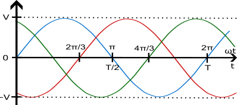

Le passage du contrôle d'une phase unique au contrôle global du moteur nécessite de maîtriser l'architecture électrique triphasée et sa résultante mécanique : le champ tournant.

# Introduction au Triphasé

Un système triphasé équilibré est composé de trois tensions alternatives de même fréquence et de même amplitude, déphasées entre elles d'un tiers de période ($$120°$$ou $$\frac{2\pi}{3}$$rad)

Les équations des tensions simples (entre la phase et le neutre) sont les suivantes :

<Columns cols={2}>
  <Column>
    $$\color{#0000c8}{v_a (t)=V_m  cos⁡(ωt)}$$ $$\color{#00c800}v_b (t)=V_m  cos⁡(ωt-\frac{2\pi}{3})$$ $$\color{#c80000}v_b (t)=V_m  cos⁡(ωt-\frac{4\pi}{3})$$
  </Column>
  <Column>
    
  </Column>
</Columns>

# Types de couplage

## Montage en étoile
