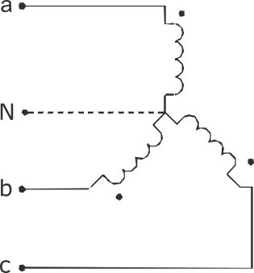

Le passage du contrôle d'une phase unique au contrôle global du moteur nécessite de maîtriser l'architecture électrique triphasée et sa résultante mécanique : le champ tournant.

# Introduction au Triphasé

Un système triphasé équilibré est composé de trois tensions alternatives de même fréquence et de même amplitude, déphasées entre elles d'un tiers de période ($$120°$$ou $$\frac{2\pi}{3}$$rad)

Les équations des tensions simples (entre la phase et le neutre) sont les suivantes :

  

    <pre>$$\color{#0000c8}{v_a (t)=V_m  cos⁡(ωt)}$$</pre>
    <pre>$$\color{#00c800}v_b (t)=V_m  cos⁡(ωt-\frac{2\pi}{3})$$</pre>
    <pre>$$\color{#c80000}v_b (t)=V_m  cos⁡(ωt-\frac{4\pi}{3})$$</pre>
  

  

    <Frame>
      
    </Frame>
  

# Types de couplage

## Montage en étoile

<Columns cols={2}>
  <Column>
    <Frame>
      
    </Frame>
  </Column>
  <Column>
    Les trois extrémités des bobines sont reliées en un point commun (point neutre $$N$$). C'est le couplage standard en Motor Control car il permet de mesurer facilement les courants de ligne (qui sont alors égaux aux courants de phase) et isole le point neutre.
  </Column>
</Columns>

## Montage en triangle

<Columns cols={2}>
  <Column>
    Les bobines sont connectées en série pour former un circuit fermé. Utilisé pour maximiser la tension aux bornes des enroulements à haute vitesse, mais rend la mesure directe des courants de phase plus complexe.
  </Column>
  <Column>
    <Frame>
      
    </Frame>
  </Column>
</Columns>

# Théorème de Ferraris

Formulé par Galileo Ferraris, ce théorème mathématique est la clé de voûte de la conversion électromécanique :

> Trois bobines géométriquement déphasées de $$120°$$dans l'espace, alimentées par trois courants déphasés de $$120°$$dans le temps, génèrent un champ magnétique unique de norme constante qui tourne dans l'espace.

# Tensions simples Vs Tensions composées

## Définitions

**Tensions simples** (Notées $$V_{aN}, V_{bN}, V_{cN}$$) : Ce sont les tensions mesurées entre chaque phase et le point neutre ($$N$$) du bobinage.

<Warning>
  On parle aussi souvent des tensions simples entre chaque phase et la masse, notées $$V_{a0}, V_{b0}, V_{c0} $$
</Warning>

**Tensions composées** (Notées $$U_{ab}, U_{bc}, U_{ca}$$) : Ce sont les tensions mesurées directement entre deux phases conductrices. Ce sont les tensions réelles "vues" par les enroulements si le neutre n'est pas connecté.

## Relations mathématiques
