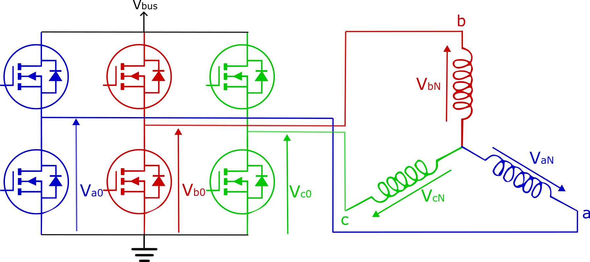
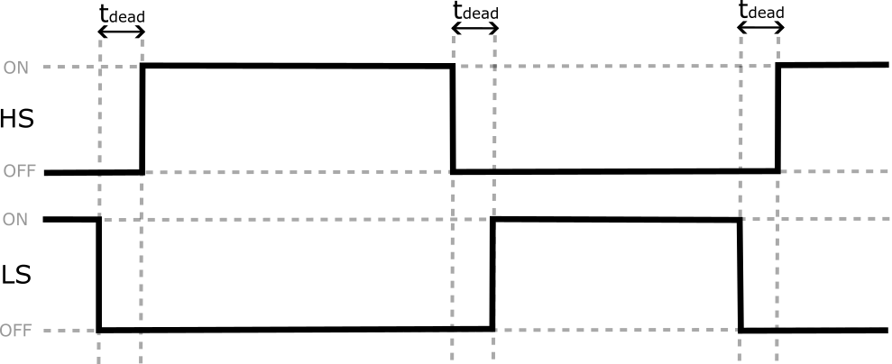

# Rôle de l'onduleur

Dans la majorité des applications, l'énergie électrique disponible provient d'une source en **courant continu (DC)** notée $$V_{bus}$$, constante par rapport au potentiel de masse de référence 0V.

L'**onduleur triphasé** (ou pont en H triphasé) constitue l'étage d'interface puissance indispensable. Il a pour fonction première de transformer cette énergie à tension continue fixe $$V_{bus}$$ en un système triphasé d'ondes de tension modulables en amplitude et en fréquence.

# Architecture matérielle

## Topologie

Pour concrétiser la conversion DC/AC et alimenter le moteur triphasé à partir d'une tension continue $$V_{bus}$$, l'onduleur repose sur un assemblage de 6 interrupteurs de puissance à commande électronique (généralement des Power MOSFETs pour les faibles/moyennes tensions jusqu'à ~100V, ou des IGBTs pour les hautes tensions véhiculaires/industrielles de 400V à 800V).

Ces 6 transistors sont organisés en 3 bras d'onduleur parallèles (un par phase du moteur) raccordés à $$V_{bus}$$. Chaque bras est composé de deux interrupteurs placés en série :

- **Transistor Haut (High-Side / HS) :** Relié entre le bus positif Vbus et la phase du moteur.
- **Transistor Bas (Low-Side / LS) :** Relié entre la phase du moteur et le rail de masse (0V ou GND).

<Frame>
  
</Frame>

## Shoot-through

La structure impose une contrainte sécuritaire absolue au niveau matériel : les deux transistors d'un même bras (Q1 et Q2) ne doivent **JAMAIS** être fermés (ON) en même temps.

Si Q1 et Q2 conduisent simultanément, même pendant quelques nanosecondes, le bus de tension $$V_{bus}$$se retrouve directement relié à la masse sans aucune résistance de charge intermédiaire. Ce phénomène, appelé **court-circuit de bras** ou **_shoot-through_**, provoque :

- Un pic d'intensité destructeur à travers les deux transistors.
- Une dissipation thermique instantanée extrême par effet Joule.
- La destruction physique irréversible des composants de puissance et parfois du driver de grille (_gate driver_).

## Dead-time

En pratique, un transistor de puissance ne bascule pas d'un état ouvert à un état fermé de façon instantanée. La charge et la décharge des capacités parasites de grille introduisent un retard à la commutation.

Si le microcontrôleur envoyait simultanément l'ordre de fermeture au transistor bas au moment exact où il ordonne l'ouverture au transistor haut, le transistor haut conduirait encore le temps d'évacuer ses charges alors que le transistor bas commencerait déjà à s'amorcer, entraînant un shoot-through éphémère à chaque période PWM.

  

    <Frame>
      
    </Frame>
  

  

    Pour garantir la sécurité de l'onduleur, on insère un intervalle de sécurité nommé temps mort (*Dead-Time*) à chaque transition.
  

  

    Pendant le temps mort, le microcontrôleur force la grille des deux transistors du bras à l'état bloqué (OFF). La phase du moteur se retrouve temporairement dans un état à haute impédance (flottante).
  

## Rôle des diodes de roue libre (Freewheeling diodes)

L'inductance propre des bobinages du moteur interdit toute interruption instantanée du courant de phase ( $$V_{L} = L\frac{di}{dt}$$).

Lorsque les deux transistors d'un bras sont ouverts pendant le tdead, le courant inductif du moteur ne s'interrompt pas : il s’échappe en passant par les **diodes de roue libre** (intégrées dans la structure intrinsèque des MOSFETs de puissance ou ajoutées en antiparallèle sur les IGBTs).

# Pilotes de grilles (Gate drivers) et interfaces de commandes

Les sorties numériques d'un microcontrôleur (typiquement $$0\text{V}$$/ $$3.3V$$avec un courant de quelques milliampères) sont incapables de piloter directement les grilles des transistors de puissance (MOSFETs ou IGBTs), qui exigent des tensions de grille plus élevées (souvent $$10V$$à $$15V$$) ainsi que des pics de courant importants pour charger et décharger rapidement leurs capacités parasites ($$C_{iss}$$).

On intercale donc un circuit intégré intermédiaire entre le microcontrôleur et l'étage de puissance : le **Gate Driver** (pilote de grille).

<Frame>
  
</Frame>

## Polarité des Signaux de Commande (_Active High_ vs _Active Low_)

Selon la topologie de la carte électronique, le modèle de _Gate Driver_ utilisé (ex. STSPIN, L6230, DRV83xx) ou la présence d'optocoupleurs d'isolation, la logique d'activation des transistors High-Side (HS) et Low-Side (LS) peut être configurée selon deux polarités :

- **Polarité Active High (Active à l'état haut) :**
  - Signal logique = `1` ($$3,3V$$) → Le transistor est **fermé (ON / passant)**.
  - Signal logique = `0` ($$0V$$) → Le transistor est **ouvert (OFF / bloqué)**.
- **Polarité Active Low (Active à l'état bas) :**
  - Signal logique = `0` ($$0V$$) → Le transistor est **fermé (ON / passant)**.
  - Signal logique = `1` ($$3,3V$$) → Le transistor est **ouvert (OFF / bloqué)**.

**Intérêt matériel :** Certains _Gate Drivers_ inversent naturellement la logique d'entrée sur leur voie Low-Side pour des raisons de sécurité matérielle (afin d'éviter un _shoot-through_ au démarrage ou en cas de perte de signal). Le paramétrage de la polarité directement dans les registres des timers du microcontrôleur (ex. _STM32CubeMX_ / _Motor Control Workbench_) permet d'adapter les sorties PWM à n'importe quel driver sans ajouter d'inverseurs logiques externes.
