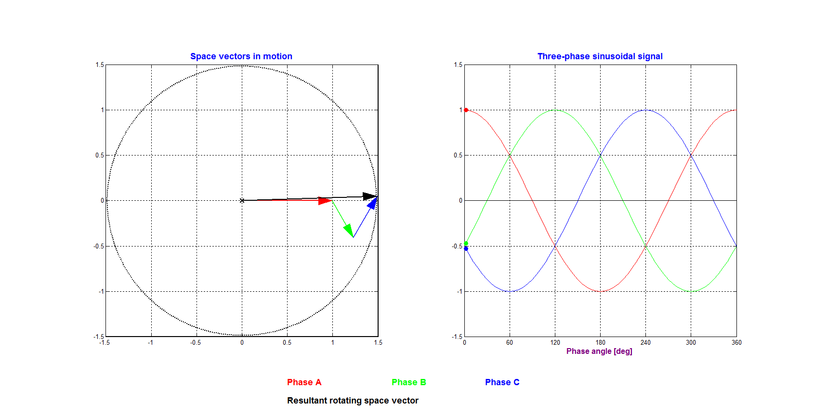

Après avoir étudié le fonctionnement de la commande Six-Step et identifié ses principales limitations, il est intéressant de se tourner vers une stratégie de commande plus avancée : le **Field Oriented Control (FOC)**. Cette approche repose sur un contrôle vectoriel du courant moteur, permettant de maîtriser indépendamment les composantes de flux et de couple. Elle offre ainsi un contrôle plus précis et plus souple du moteur, notamment à basse vitesse, tout en améliorant les performances dynamiques et le rendement énergétique.

# Du contrôle en tension au contrôle en courant

Dans une commande Six-Step classique, les phases du moteur sont alimentées selon une séquence de commutation prédéfinie. Le contrôleur impose principalement une tension aux bornes des enroulements, et le courant résultant dépend alors de la tension appliquée, de la vitesse de rotation et des caractéristiques électriques du moteur.

Le FOC adopte une approche différente : plutôt que de piloter directement les tensions de phase, il cherche à contrôler précisément les courants circulant dans les enroulements.

Ce choix est particulièrement intéressant car le couple électromagnétique d'un moteur synchrone est directement lié aux courants statoriques et à leur orientation par rapport au champ magnétique du rotor.

En contrôlant les courants, il devient donc possible d'agir directement sur la production du couple, avec une meilleure maîtrise de la dynamique du moteur.

# Le courant comme vecteur

Dans un moteur triphasé, les courants circulant dans les trois enroulements ne sont pas indépendants. Ils sont décalés dans le temps et dans l'espace de 120° électriques.

On peut représenter ces trois courants par un unique vecteur résultant appelé **vecteur courant statorique**.

<Frame>
  
</Frame>

Ce vecteur possède deux caractéristiques essentielles :

- **Son amplitude**, qui représente l'intensité du courant statorique.
- **Son orientation**, qui définit sa position angulaire par rapport au rotor.

C'est précisément cette orientation qui est fondamentale pour le contrôle du moteur. En effet, selon la position du vecteur courant par rapport au champ magnétique du rotor, le courant contribue différemment à la production du flux magnétique et du couple électromagnétique.

Le principe du FOC consiste donc à maîtriser non seulement l'amplitude du courant, mais également son orientation.

# Changement de repère

Dans le repère naturel du stator (repère triphasé), les courants sont sinusoïdaux et varient en permanence au cours de la rotation du moteur.

Leur représentation et leur régulation sont donc relativement complexes : les grandeurs que l'on souhaite contrôler varient continuellement, même lorsque le moteur fonctionne à vitesse et charge constantes.

L'idée fondamentale du FOC est de changer de référentiel pour se placer dans un repère tournant à la même vitesse électrique que le rotor.

L'intérêt de ce changement de repère est majeur : les composantes du courant, qui évoluent continuellement dans le référentiel du stator, deviennent idéalement constantes en régime permanent dans le référentiel tournant.

On transforme ainsi un problème de régulation de grandeurs sinusoïdales en un problème de régulation de grandeurs continues, beaucoup plus simple à traiter avec des régulateurs classiques de type PI.

<Info>
  Le FOC repose sur une idée fondamentale : **contrôler le vecteur courant statorique dans un référentiel aligné avec le flux magnétique du rotor**.
</Info>

Pour réaliser cette transformation, deux opérations mathématiques sont nécessaires : **la transformation de Clarke**, qui permet de passer du repère triphasé abc au repère orthogonal αβ, puis **la transformation de Park**, qui permet de passer du repère αβ au repère tournant d-q.

Ces deux transformations constituent les fondements mathématiques du FOC et seront détaillées dans le chapitre suivant.
