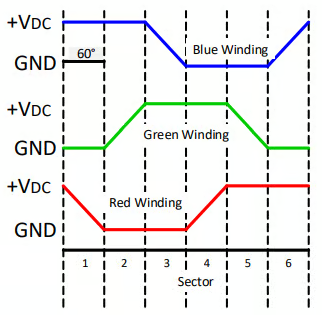

La **commutation trapézoïdale** (ou algorithme **6-Step**) est la méthode historique la plus directe pour piloter un moteur brushless (particulièrement adapté aux moteurs BLDC à force contre-électromotrice trapézoïdale).

## Le rôle des trois phases

À chaque pas (step) de 60°, la puissance est distribuée en appliquant une règle stricte d'affectation des 3 phases du stator :

- **1 Phase active raccordée au rail positif (**$$V_{bus}$$**) :** Son transistor _High-Side_ (HS) est fermé (ou modulé en PWM). Le courant entre par cette phase.
- **1 Phase active raccordée à la masse (0V) :** Son transistor _Low-Side_ (LS) est fermé. Le courant ressort par cette phase.
- **1 Phase flottante (Haute impédance / Non alimentée) :** Ses deux transistors (HS et LS) sont ouverts (OFF). Aucun courant provenant de l'onduleur n'y est injecté.

<Tip>
  **Avantage clé de la phase flottante :** Comme aucun courant fourni par l'onduleur n'y circule, le potentiel de cette phase est uniquement dicté par la [Force Contre-Électromotrice (**BEMF**)](/chapitre-i-l-electromagnetisme#la-force-électromotrice-fem-ou-back-emf) induite par le mouvement des aimants du rotor. Cela permet de détecter son passage par zéro (_Zero-Crossing Detection_) en mode sans capteur (_sensorless_).
</Tip>

## La table des commutations

Pour entretenir le couple électromagnétique et faire tourner le moteur, le champ statorique doit constamment conserver une avance d'angle par rapport au champ rotorique. Pour cela, l'onduleur enchaîne cycliquement 6 combinaisons de conduction :

  

    <table>
      <colgroup>
        <col width="74" />

        <col width="116" />

        <col width="87" />

        <col width="86" />

        <col width="90" />

        <col width="91" />
      </colgroup>

      <thead>
        <tr>
          <th>Pas  (step)</th>
          <th>Secteur angulaire</th>
          <th>Phase à Vbus (HS ON)</th>
          <th>Phase à 0V (LS ON)</th>
          <th>Phase flottante (OFF)</th>
          <th>Sens du courant</th>
        </tr>
      </thead>

      <tbody>
        <tr>
          <td>Step 1</td>
          <td>0° - 60°</td>
          <td>A</td>
          <td>B</td>
          <td>C</td>
          <td>A <Icon icon="arrow-right-long" color="#64748B" /> B</td>
        </tr>

        <tr>
          <td>Step 2</td>
          <td>60° - 120°</td>
          <td>A</td>
          <td>C</td>
          <td>B</td>
          <td>A <Icon icon="arrow-right-long" color="#64748B" /> C</td>
        </tr>

        <tr>
          <td>Step 3</td>
          <td>120° - 180°</td>
          <td>B</td>
          <td>C</td>
          <td>A</td>
          <td>B <Icon icon="arrow-right-long" color="#64748B" /> C</td>
        </tr>

        <tr>
          <td>Step 4</td>
          <td>180° - 240°</td>
          <td>B</td>
          <td>A</td>
          <td>C</td>
          <td>B <Icon icon="arrow-right-long" color="#64748B" /> A</td>
        </tr>

        <tr>
          <td>Step 5</td>
          <td>240° - 300°</td>
          <td>C</td>
          <td>A</td>
          <td>B</td>
          <td>C <Icon icon="arrow-right-long" color="#64748B" /> A</td>
        </tr>

        <tr>
          <td>Step 6</td>
          <td>300° - 360°</td>
          <td>C</td>
          <td>B</td>
          <td>A</td>
          <td>C <Icon icon="arrow-right-long" color="#64748B" /> B</td>
        </tr>
      </tbody>
    </table>
  

  

    
  

<Frame>
  
</Frame>
