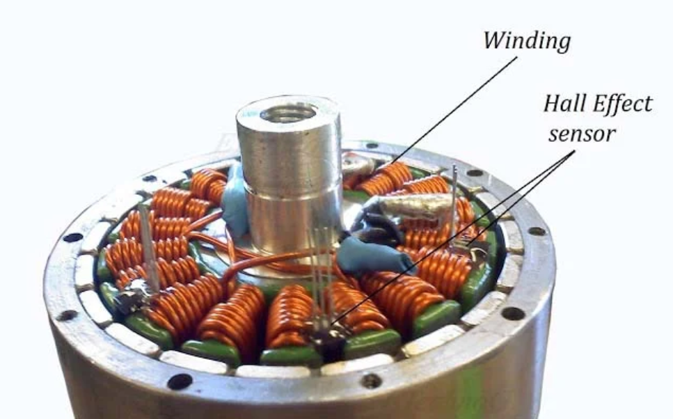
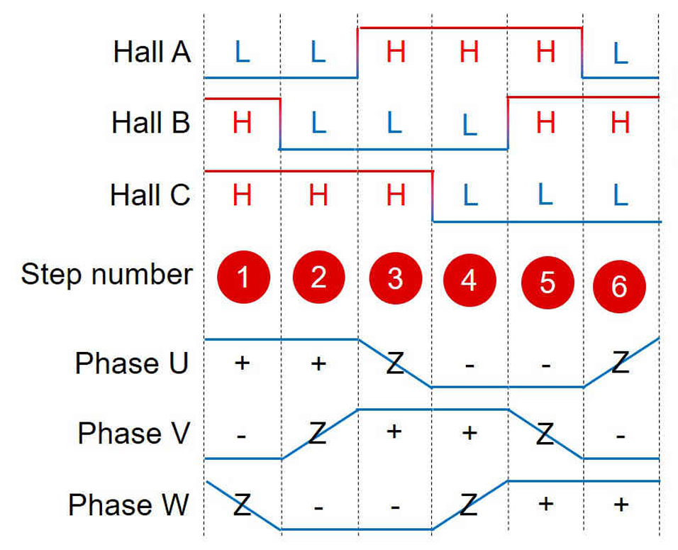

Pour appliquer la bonne séquence de commutation parmi les 6 pas de l'algorithme 6-Step, l'onduleur doit connaître en permanence la position angulaire du rotor.

La méthode la plus directe et robuste en boucle fermée repose sur l'utilisation de **capteurs à effet Hall**.

# Principe

<Columns cols={2}>
  <Column>
    Les capteurs à effet Hall sont des capteurs magnétiques numériques placés au stator du moteur. Ils réagissent directement au champ magnétique produit par les aimants permanents du rotor.

    Un capteur délivre un niveau logique 1 (HIGH) lorsqu'un pôle Nord passe en face de lui. Il délivre un niveau logique 0 (LOW) à l'approche d'un pôle Sud.
  </Column>
  <Column>
    <Frame>
      
    </Frame>
  </Column>
</Columns>

Pour un moteur triphasé, on place 3 capteurs Hall (H1, H2, H3 ou HA, HB, HC) déphasés de 120° électriques (ou 60° selon le modèle matériel). Le déphasage de 120° électrique s'exprime en degrés mécaniques selon le nombre de paires de pôles $$p$$ du moteur :

$$
θ_{mécanique}= \frac{θ_{électrique}}{p}=\frac{120°}{p}
$$

# Décodage du mot binaire (hall state)

<Columns cols={2}>
  <Column>
    À mesure que le rotor tourne, la combinaison des signaux des 3 capteurs produit un **mot binaire à 3 bits** (H1, H2, H3). Dans une configuration standard déphasée de 120°, **6 combinaisons valides sur 8** sont générées successivement au cours d'un cycle électrique complet (360°) :

    $$
    \{001_2,011_2,010_2,110_2,100_2,101_2\}
    $$
  </Column>
  <Column>
    
  </Column>
</Columns>

Les états $$000_2$$(0) et $$111_2$$(7) sont physiquement impossibles avec une disposition à 120°.

<Warning>
  _L'ordre exact du binaire Hall dépend du sens de rotation du moteur et du câblage physique des capteurs par rapport aux phases A, B, C._
</Warning>
