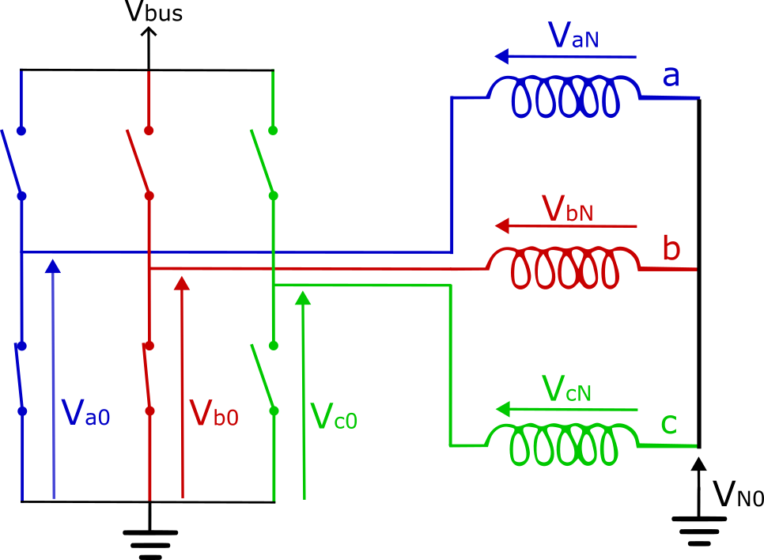
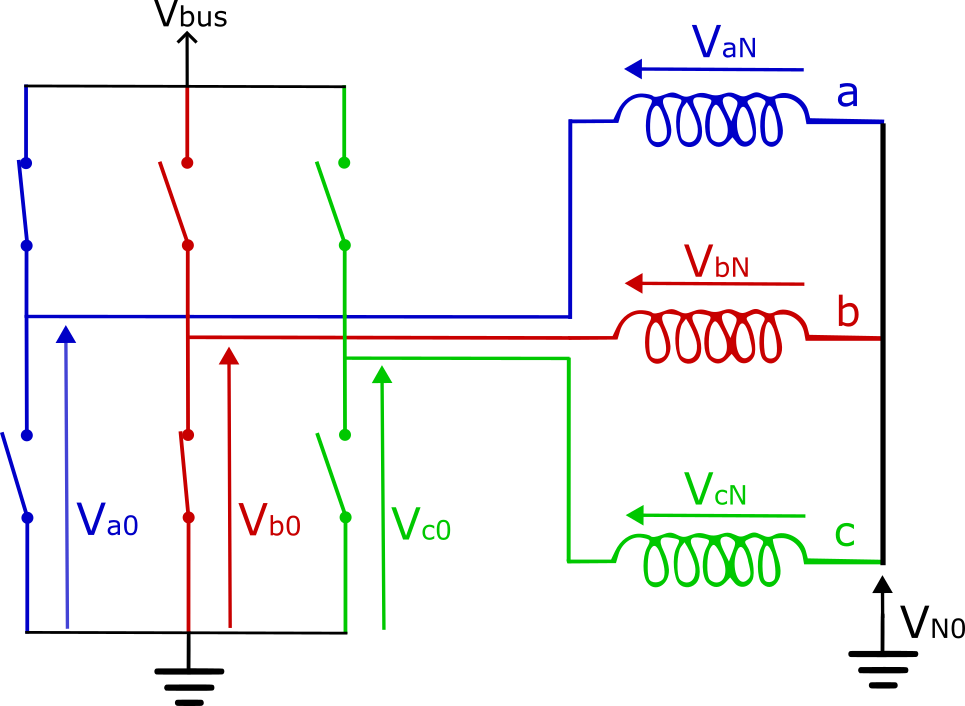
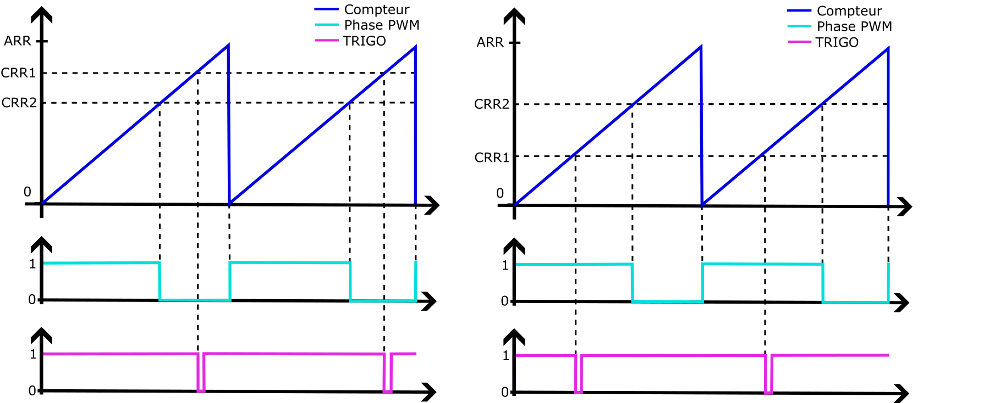
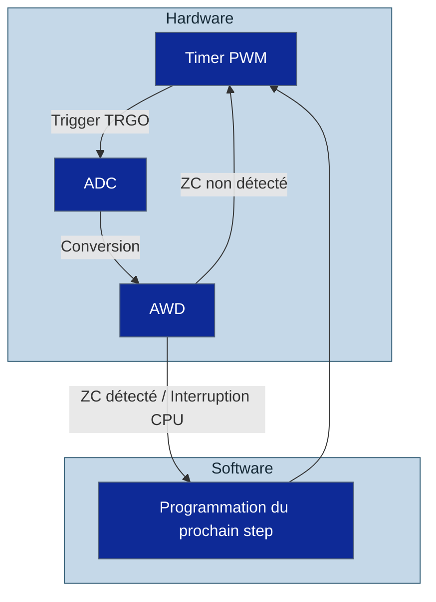

Le pilotage en mode **sans capteur (_Sensorless_)** permet d'éliminer les capteurs physiques à effet Hall pour réduire le coût matériel, l'encombrement, la filerie et augmenter la fiabilité du système (particulièrement dans les milieux hostiles ou immergés).

En commutation 6-step, la position du rotor est reconstituée en mesurant la **Force Contre-Électromotrice (BEMF)** générée par la rotation des aimants permanents au niveau de la phase non alimentée (phase flottante).

# Exploitation de la phase flottante

À chaque pas de 60° de la commutation 6-step, l'onduleur laisse volontairement une phase déconnectée de toute alimentation (transistors High-Side et Low-Side à l'état OFF). La tension  mesurée sur le fil de cette phase par rapport à la masse de l'onduleur (Vflottante0) vaut :

$$
V_{flottante0}=V_{N0} + e_{flottante}
$$

Où:

- $$V_{N0}$$ est le potentiel du point neutre du moteur par rapport à la masse
- $$e_{flottante0}$$ est la Force Contre-Électromotrice (**BEMF**) induite dans la bobine par le rotor en mouvement.

<Accordion title="En savoir plus ?" className="en-savoir-plus">
  <Frame>
    
  </Frame>

  La tension d'une phase par rapport à la masse vaut :

  $$
  V_{a0} = V_{N0} + Ri(t)+L\frac{di(t)}{dt} + e(t)
  $$

  Quand la phase est flottante; $$i(t) = 0$$. Donc la tension de la phase par rapport à la masse devient :

  $$
  V_{a0} = V_{N0}+e(t)
  $$
</Accordion>

# Détection du passage par zéro

Au cours de l'intervalle de 60° électriques où une phase est flottante, la BEMF $$e(t)$$ de cette phase passe d'une polarité à l'autre en franchissant la valeur zéro. Le moment précis où la BEMF croise la valeur **<u>du point neutre</u>** s'appelle le **passage par zéro** (_Zero-Crossing Point_).

<Columns cols={2}>
  <Column>
    Pour maintenir un couple électromagnétique maximal (orientation optimale du champ magnétique statorique à 90° en moyenne par rapport au rotor), la commutation du pas suivant doit intervenir exactement _30°_ **électriques après** l'instant du passage par zéro (ZCD).
  </Column>
  <Column>
    <Frame>
      
    </Frame>
  </Column>
</Columns>

# Détermination du seuil

Le passage par zéro (**Zero-Crossing Point**) correspond à l'instant précis où la BEMF de cette phase flottante franchit la valeur zéro **<u>par rapport au</u>**<u> point neutre</u> du moteur.

<Tip>
  **Rappel :** Sur la phase flottante : $$V_{0}(t) ​=V_{N0} +e(t) ​$$
</Tip>

Si $$e(t) = 0$$ alors $$V_0(t) = V_{N0}$$

Rechercher le moment où la phase flottante franchit la valeur zéro, revient à chercher le moment où la tension de la phase **<u>par rapport à la masse</u>** vaut $$V_{N0}.$$

Il est donc indispensable de connaître la tension du point neutre pour déterminer le passage à zéro de la BEMF.

# Calcul de la tension du neutre

<Columns cols={3}>
  <Column>
    $$V_{a0} = V_{N0}+V_{aN}$$
  </Column>
  <Column>
    $$V_{b0} = V_{N0}+V_{bN}$$
  </Column>
  <Column>
    $$V_{c0} = V_{N0}+V_{cN}$$
  </Column>
</Columns>

Donc on a :

$$
V_{a0}+V_{b0}+V_{c0}= 3V_{N0} + (V_{aN} + V_{bN} + V_{cN})
$$

<Tip>
  **Rappel :** Dans tout système triphasé en étoile à neutre isolé, on a : $$V_{aN}+V_{bN}+V_{cN}=0$$ (voir [Chapitre III – Montage en étoile](/chapitre-iii-les-systemes-triphases))
</Tip>

$$
V_{N0} = \frac{V_{a0}+V_{b0}+V_{c0}}{3}
$$

La suite du calcul de la tension du point neutre dépend de l'état de la PWM. Le calcul peut se faire pendant la PWM ON ou pendant la PWM OFF.

## PWM off-time

<Columns cols={2}>
  <Column>
    Pendant le _"PWM off-time"_, les transistors LS des deux phases actives sont passants.

    Dans cet exemple, la phase alimentée en PWM est $$\color{0000c8}a$$ a et la phase flottante est $$\color{00c800}c$$.

    

  
$$V_{a0} = 0$$

  
$$V_{b0} = 0$$

  
$$V_{c0} = V_{N0}$$

  </Column>
  <Column>
    <Frame>
      
    </Frame>
  </Column>
</Columns>

$$⇒ V_{N0} = \frac{V_{N0}}{3}   ⇒ \bold{V_{N0} = 0}$$

<Check>
  **Conclusion :** Dans le cas d'un calcul sur le PWM off-time, on cherche le moment où la tension de la phase flottante par rapport à la masse passe par **0V**.
</Check>

## PWM on-time

<Columns cols={2}>
  <Column>
    Pendant le _"PWM on-time"_, le transistor HS de la phase ON et le transistor LS de la phase OFF sont passants.

    Dans cet exemple, la phase alimentée en PWM est $$\color{0000c8}a$$ a et la phase flottante est $$\color{00c800}c$$.

    

  
$$V_{a0} = V_{bus}$$

  
$$V_{b0} = 0$$

  
$$V_{c0} = V_{N0}$$

  </Column>
  <Column>
    <Frame>
      
    </Frame>
  </Column>
</Columns>

$$⇒ V_{N0} = \frac{V_{bus}+V_{N0}}{3}   ⇒ \bold{V_{N0}=\frac{V_{bus}}{2}}$$

<Check>
  **Conclusion :** Dans le cas d'un calcul sur le PWM on-time, on cherche le moment où la tension de la phase flottante par rapport à la masse passe par $$\frac{V_{bus}}{2}$$.
</Check>

## Déclenchement de l'ADC et Watchdog

Pour réaliser la détection de passage par zéro (ZCD) de la BEMF sans impacter les performances du processeur, le microcontrôleur s'appuie sur un couplage matériel direct entre le **Timer PWM**, le convertisseur **ADC** et le périphérique de **Watchdog Analogique** (_Analog Watchdog_ - AWD).

## Synchronisation du déclenchement

Afin d'éviter de mesurer la tension pendant les transitoires de commutation des MOSFETs (source de bruit haute fréquence), l'échantillonnage de la phase flottante doit être parfaitement synchronisé avec le hachage de l'onduleur.

Le timer avancé (ex: TIM1 ou TIM8) émet une impulsion d'amorce matérielle (**TRGO**) à un instant précis de sa période de comptage :

- En mode **PWM OFF-time**, le déclenchement est positionné au milieu de la fenêtre d'extinction des transistors High-Side.
- En mode **PWM ON-time**, il est calé au centre du créneau d'allumage du High-Side.

Ce signal TRGO déclenche automatiquement la conversion de la voie analogique associée à la phase flottante via un canal **ADC Injected** (ou canal Regular dédié). La numérisation s'effectue sans aucune latence ni intervention du CPU.

## Surveillance par Watchdog Analogique (AWD)

Plutôt que d'interrompre le processeur à chaque cycle PWM pour vérifier numériquement si la tension convertie a franchi le seuil, l'algorithme exploite le **Watchdog Analogique (AWD)** intégré à l'ADC.

Le CPU programme au préalable les registres de seuil du Watchdog Analogique (ADC_HTR et ADC_LTR) avec la valeur numérique correspondant au seuil théorique calculé. À chaque conversion déclenchée par la PWM, le périphérique ADC compare automatiquement la donnée mesurée par rapport à ces bornes.

Tant que la BEMF ne franchit pas la fenêtre définie, la conversion s'effectue silencieusement en matériel ; **aucune interruption n'est envoyée au CPU**, ce qui laisse le processeur 100 % disponible pour d'autres tâches.

Dès que la tension de la phase flottante passe au-dessus (ou en dessous) du seuil prédéfini, l'AWD lève immédiatement un drapeau matériel et génère **une unique interruption**.

Cette interruption événementielle avertit instantanément le logiciel du franchissement du passage par zéro, déclenchant alors le calcul de la vitesse et l'armement de la temporisation pour la commutation du pas suivant.

