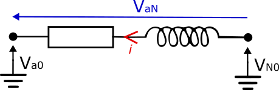

Le pilotage en mode **sans capteur (_Sensorless_)** permet d'éliminer les capteurs physiques à effet Hall pour réduire le coût matériel, l'encombrement, la filerie et augmenter la fiabilité du système (particulièrement dans les milieux hostiles ou immergés).

En commutation 6-step, la position du rotor est reconstituée en mesurant la **Force Contre-Électromotrice (BEMF)** générée par la rotation des aimants permanents au niveau de la phase non alimentée (phase flottante).

# Exploitation de la phase flottante

À chaque pas de 60° de la commutation 6-step, l'onduleur laisse volontairement une phase déconnectée de toute alimentation (transistors High-Side et Low-Side à l'état OFF). La tension  mesurée sur le fil de cette phase par rapport à la masse de l'onduleur (Vflottante0) vaut :

$$
V_{flottante0}=V_{N0} + e_{flottante}
$$

Où:

- $$V_{N0}$$ est le potentiel du point neutre du moteur par rapport à la masse
- $$e_{flottante0}$$ est la Force Contre-Électromotrice (**BEMF**) induite dans la bobine par le rotor en mouvement.

<Accordion title="En savoir plus ?">
  <Frame>
    
  </Frame>

  La tension d'une phase par rapport à la masse vaut :

  $$
  V_{a0} = V_{N0} + Ri(t)+L\frac{di(t)}{dt} + e(t)
  $$

  Quand la phase est flottante; $$i(t) = 0$$. Donc la tension de la phase par rapport à la masse devient :

  $$
  V_{a0} = V_{N0}+e(t)
  $$
</Accordion>

# Détection du passage par zéro

Au cours de l'intervalle de 60° électriques où une phase est flottante, la BEMF $$e(t)$$ de cette phase passe d'une polarité à l'autre en franchissant la valeur zéro. Le moment précis où la BEMF croise la valeur **<u>du point neutre</u>** s'appelle le **passage par zéro** (_Zero-Crossing Point_).

<Columns cols={2}>
  <Column>
    Pour maintenir un couple électromagnétique maximal (orientation optimale du champ magnétique statorique à 90° en moyenne par rapport au rotor), la commutation du pas suivant doit intervenir exactement _30°_ **électriques après** l'instant du passage par zéro (ZCD).
  </Column>
  <Column>
    <Frame>
      
    </Frame>
  </Column>
</Columns>

# Détermination du seuil

Le passage par zéro (**Zero-Crossing Point**) correspond à l'instant précis où la BEMF de cette phase flottante franchit la valeur zéro **<u>par rapport au</u>**<u> **point neutre**</u> du moteur.
