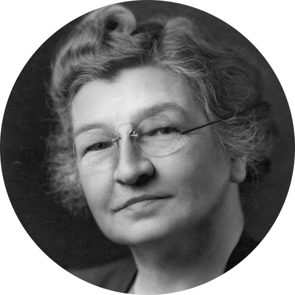
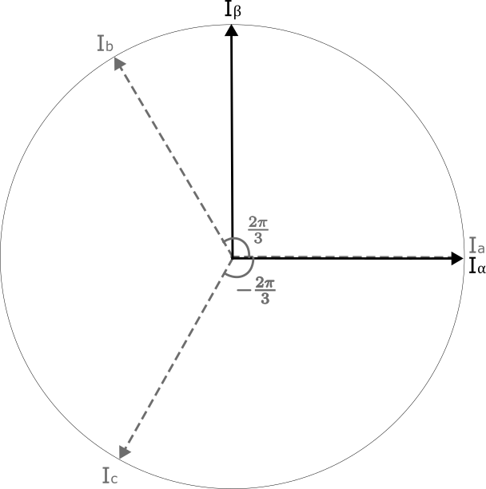
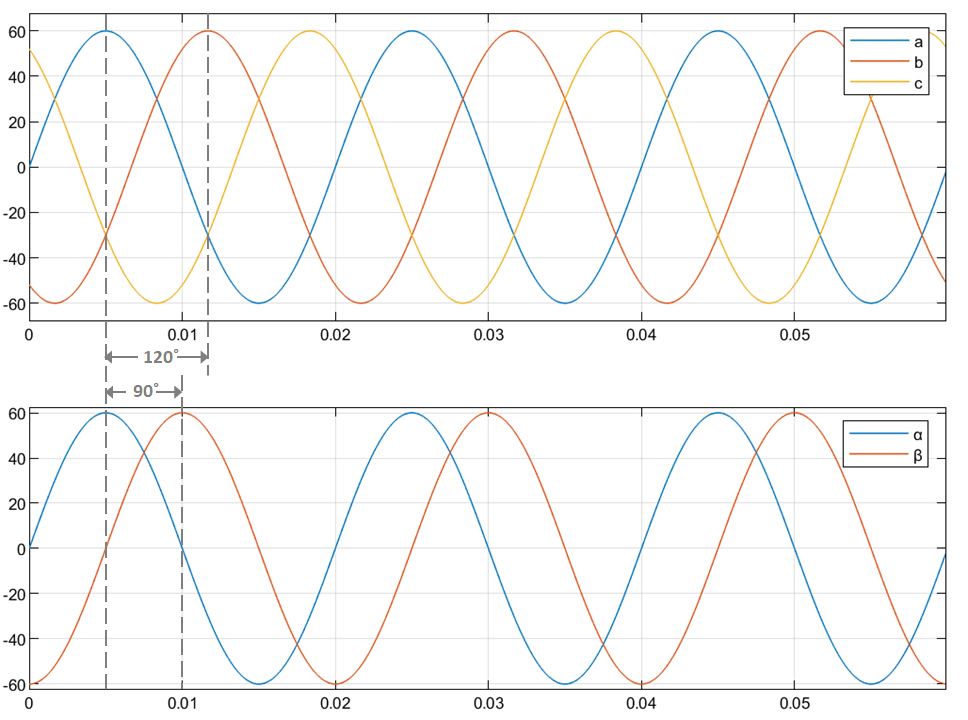
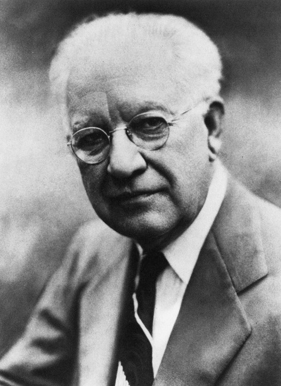

# Transformée de Clarke (3 axes → 2 axes fixes)

La transformée de Clarke consiste à projeter les 3 axes physiques du moteur $$a,b,c$$ (séparés de 120°) sur un repère orthogonal composé de seulement deux axes appelés $$\alpha$$ et $$\beta$$.

<Accordion title="Edith Clarke (1883 - 1959)">
  <Columns cols={2}>
    <Column>
      Edith Clarke (1883–1959) était une ingénieure électricienne et mathématicienne américaine, pionnière dans le domaine du génie électrique.

      Diplômée du MIT en 1919, elle fut la première femme à obtenir un diplôme en génie électrique de cette institution. Elle a notamment travaillé chez General Electric, où elle a développé des méthodes mathématiques permettant de simplifier l'analyse des réseaux électriques.
    </Column>
    <Column>
      <Frame>
        
      </Frame>
    </Column>
  </Columns>

  La transformation de Clarke, qui porte son nom, permet de représenter un système triphasé dans un référentiel orthogonal à deux axes (αβ), en remplaçant trois grandeurs de phase par deux composantes équivalentes. Cette représentation simplifie considérablement l'analyse et le contrôle des machines électriques.

  Elle fut également la première femme à devenir professeure titulaire de génie électrique à l'Université du Texas à Austin, en 1947.

  _Un bel héritage pour une ingénieure qui a contribué à rendre les systèmes électriques plus faciles à comprendre et à calculer !_
</Accordion>

> Comment passe-t-on d'un système à trois axes à un système à deux axes sans perte d'information ?

La condition magique : un **système équilibré**. Dans un moteur triphasé dont les bobines sont connectées en étoile, le courant qui rentre par une phase doit obligatoire ressortir par les deux autres.

Physiquement, la somme des trois courants est donc **toujours nulle** à chaque instant:

$$
I_a(t)+I_b(t)+I_c(t)=0
$$

> Pourquoi ça change tout ?

En algèbre linéaire, si on a 3 variables ( $$I_a, I_b, I_c)$$ mais qu'une équation les lie, cela signifie que le système n'a en réalité que 2 degrés de liberté.

La troisième variable est redondante, si on connait $$I_a$$et $$I_b$$ on connait automatiquement $$I_c$$.

Le système en 3D est en fait coincé sur un plan en 2D qui flotte dans l'espace. La transformée de Clarke ne fait rien d'autre que poser ce plan à plat.

> Comment fonctionne la projection concrètement ? 

<Columns cols={2}>
  <Column>
    
  </Column>
  <Column>
    $$
    \left\{
\begin{aligned}
I_a &= I_\alpha \\
I_b &= \cos\left(\frac{2\pi}{3}\right)I_\alpha + \sin\left(\frac{2\pi}{3}\right)I_\beta \\
I_c &= \cos\left(-\frac{2\pi}{3}\right)I_\alpha + \sin\left(-\frac{2\pi}{3}\right)I_\beta
\end{aligned}
\right.
    $$

    $$<=>\left\{\begin{aligned}I_a &= I_\alpha \\I_b &= -\frac{1}{2}I_\alpha + \frac{\sqrt{3}}{2}I_\beta \\I_c &= -\frac{1}{2}I_\alpha - \frac{\sqrt{3}}{2}I_\beta\end{aligned}\right.$$
  </Column>
</Columns>

<Frame>
  $$
  \begin{aligned}I_\alpha &= I_a  \\I_\beta &= \frac{1}{\sqrt{3}}(I_b-I_c)\end{aligned}
  $$
</Frame>

A ce stade, les courants $$I_\alpha$$et $$I_\beta$$ sont toujours des sinusoïdes qui oscillent. Le problème du PI n'est donc pas encore résolu.

# Transformée de Park (2 axes fixes → 2 axes tournants)

C'est tout le génie de l'algorithme FOC; au lieu de regarder le moteur depuis l'extérieur (repère fixe), on va le regarder depuis le rotor.

<Accordion title="Robert H. Park (1902–1994)">
  <Columns cols={2}>
    <Column>
      Robert H. Park (1902–1994) était un ingénieur américain, reconnu pour ses contributions majeures à l'analyse et à la modélisation des machines électriques.

       

      En 1929, il publia un article fondateur introduisant une transformation mathématique permettant de représenter les grandeurs électriques d'une machine dans un référentiel tournant, synchronisé avec le rotor. Cette approche, aujourd'hui connue sous le nom de _transformation de Park_, a profondément simplifié l'analyse des machines électriques en transformant des grandeurs sinusoïdales variables en grandeurs plus faciles à exploiter dans un référentiel adapté.
    </Column>
    <Column>
      <Frame>
        
      </Frame>
    </Column>
  </Columns>

  La transformation de Park constitue aujourd'hui l'un des fondements du _Field Oriented Control_ (FOC).
</Accordion>
