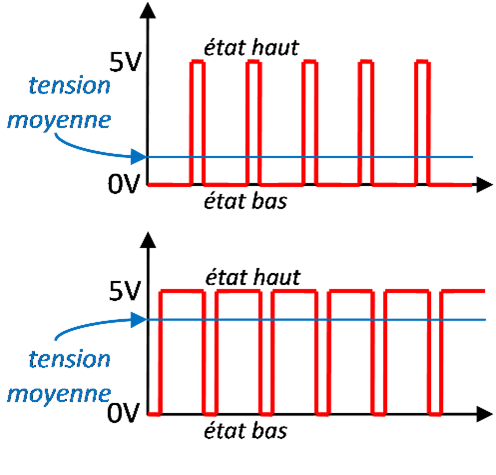
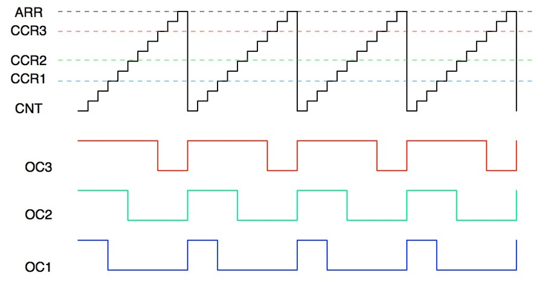
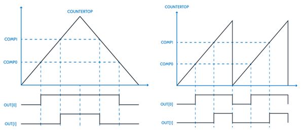

Dans le contrôle des moteurs brushless (PMSM / BLDC), deux grandes familles de modulation sont utilisées pour faire varier l'amplitude et la fréquence des sinusoïdes fondamentales : SPWM et SVPWM.

Pour comprendre le fonctionnement de ces dernières, il faut déjà comprendre le fonctionnement d’une PWM classique.

La **Modulation de Largeur d'Impulsion (MLI)** ou **PWM** (_Pulse Width Modulation_) est la technique fondamentale qui permet de piloter une charge électrique (comme la bobine d'un moteur) en faisant varier la valeur moyenne d'une tension continue fixe (Vbus) par un découpage à haute fréquence.

# Principe de base : du Tout-ou-Rien au Continu Moyen

On découpe la tension fixe Vbus à une fréquence de découpage constante (généralement entre 10kHz et 20kHz en contrôle moteur).

La tension moyenne aperçue par la charge sur une période Tpwm est directement proportionnelle au temps d'allumage Ton :

$$
V_{moyen} = \alpha \cdot V_{bus}
$$

Où $$\alpha$$ est le **rapport cyclique** (_Duty Cycle_), défini par :

$$
\alpha = \frac{T_{on}}{T_{pwm}}
$$

avec $$0 ≤ \alpha ≤ 1$$

# Tension lissée

Les enroulements du moteur sont des bobines inductive (L). L'inductance s'oppose aux variations brusques du courant selon la loi : $$V_L = L \frac{di}{dt}$$.

<Columns cols={2}>
  <Column>
    - Pendant Ton : Le courant monte progressivement dans la bobine.

    - Pendant Toff : Le courant continue de circuler à travers les diodes de roue libre et descend progressivement.

    Le moteur agit donc comme un filtre passe-bas naturel : le découpage rapide (plusieurs kilohertz) est lissé, et le courant résultant suit fidèlement la tension moyenne.
  </Column>
  <Column>
    
  </Column>
</Columns>

# Mode de génération

La génération d’une PWM est faite avec un timer et un seuil appelé « Compare Ratio ». Quand le compteur franchit le seuil (dans un sens ou dans l’autre), la PWM change de polarité.

<Frame>
  
</Frame>

- **TIMx_ARR (Auto-Reload Register) :** Fixe la période de la PWM (la fréquence de découpage fpwm).
- **TIMx_CNT (Counter) :** Le compteur interne qui s'incrémente (ou décrémente) à chaque coup d'horloge.
- **TIMx_CCRx (Capture/Compare Register) :** Il contient la valeur seuil qui définit le temps d'allumage Ton.

Ici, les PWM ont leurs fronts montants alignés (edge-aligned PWM). On pourrait aussi centrer les PWM (center-aligned PWM) en utilisant un compteur « up and down ».

<Frame>
  
</Frame>

# Advanced-Control Timers

Sur les STM32, il existe des timers standards (TIM2, TIM3...) et des **Advanced-Control Timers** (TIM1, TIM8, TIM20). Ces derniers sont spécialement conçus pour le contrôle de moteurs triphasés et l'électronique de puissance.

Voici les fonctionnalités matérielles uniques qu'ils apportent :

- **Génération de sorties complémentaires (CHx et CHxN) :** Un bras d'onduleur a besoin de deux commandes, une pour le MOSFET High-Side et une pour le Low-Side LS. Les Advanced Timers génèrent automatiquement la paire de signaux opposés à partir d'un seul registre `CCR1`.
- **Générateur de Temps Mort Intégré (Dead-Time Generator - DTG) :** Pour éviter le court-circuit de bras (shoot-through), le matériel insère un retard paramétrable via le registre `BDTR` (Break and Dead-Time Register). Le calcul du temps mort est géré à 100 % par le matériel sans aucune surcharge CPU.
- **Entrée d'Arrêt d'Urgence (Break Input / BRK) :** Le timer possède une broche matérielle dédiée reliée aux protections d'intensité. Si un surcourant est détecté, l'entrée _Break_ désactive immédiatement les grilles de tous les MOSFETs en quelques nanosecondes, indépendamment du code logiciel.
- **Synchronisation matérielle avec l'ADC (Trigger Output - TRGO) :** En contrôle vectoriel (FOC), il est impératif de mesurer le courant au milieu des impulsions PWM (lorsque le bruit de commutation est minimal). L'Advanced Timer génère un signal d'amorce (_Trigger TRGO_) à la crête du compteur (`CNT == ARR` ou `CNT == 0`) pour lancer la conversion de l'ADC automatiquement sans interruption CPU.
- **Gestion de la commutation 6-Step (Registre COM / Event) :** Pour le contrôle trapézoïdal (6-Step), le registre `COM` (_Commutation Event_) permet de pré-charger la configuration des 6 transistors pour l'état suivant et d'appliquer le changement de pas simultanément sur un événement d'amorce externe (ex. signal des capteurs à effet Hall).
