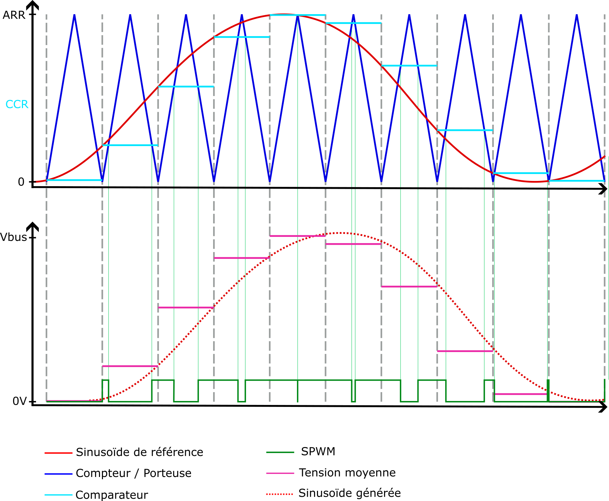
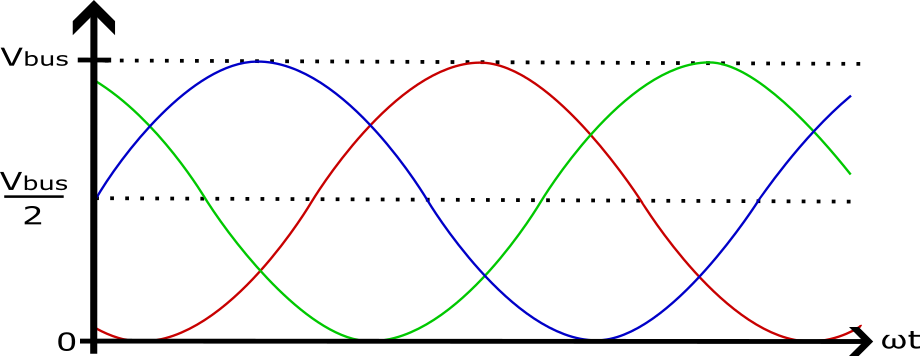
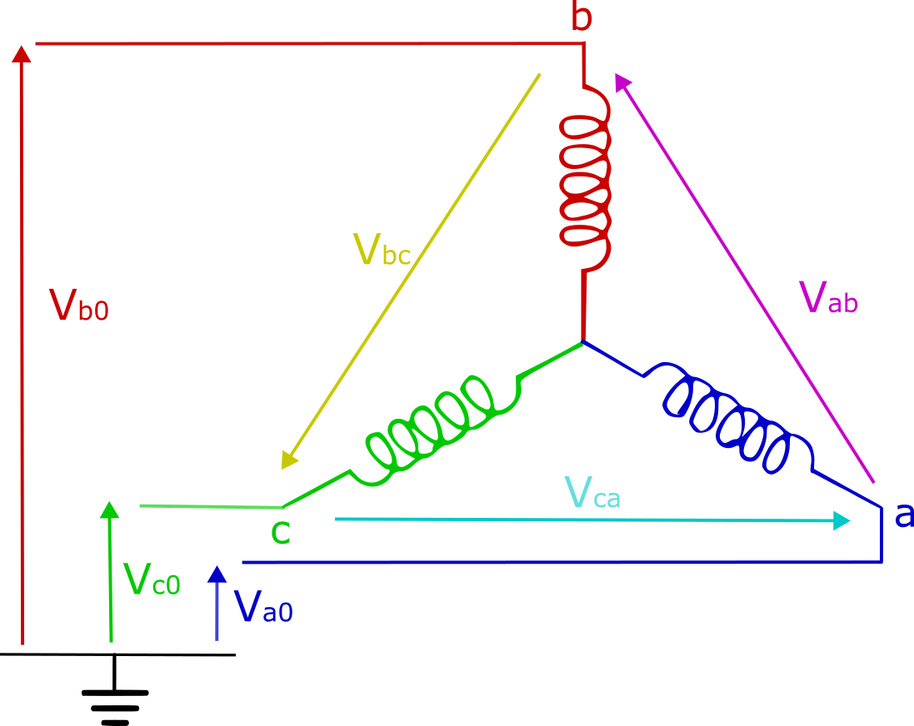
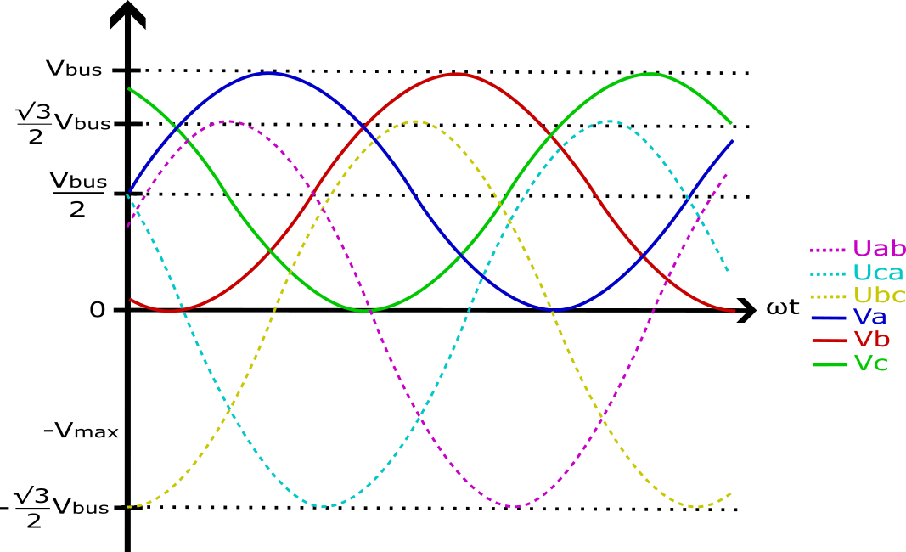

A la sortie de Clarke inversé, on a les tensions sinusoïdales théoriques des trois phases. Il faut les convertir en signaux gérables par un microcontrôleur : des PWM.

# Principe de fonctionnement

Pour générer une tension moyenne sinusoïdale, il faut adapter le Compare Ratio en temps réel.

A chaque interruption timer, on adapte le comparateur avec une sinusoïde de référence :

- Lorsque la modulante est supérieure à la porteuse, le transistor HS est fermé (Va0 = Vbus).
- Lorsque la modulante est inférieure, le transistor LS est fermé (Va0 = 0V).

<Frame>
  
</Frame>

# Inconvénient

<Columns cols={2}>
  <Column>
    On obtient donc une sinusoïde qui oscille autour de $$\frac{V_{bus}}{2}.$$

    Cette sinusoïde est générée pour les 3 phases $$V_{a0}$$, $$V_{b0}$$ et $$V_{c0}$$. Elles sont décalées de 120 degrés les unes par rapport aux autres.
  </Column>
  <Column>
    <Frame>
      
    </Frame>
  </Column>
</Columns>

<Columns cols={2}>
  <Column>
    <Frame>
      
    </Frame>
  </Column>
  <Column>
     

     

     

    $$
    \left\{
\begin{aligned}
V_{a0}(t)&=\frac{V_{bus}}{2} + \frac{V_{bus}}{2} \sin(\omega t) \\
V_{b0}(t)&=\frac{V_{bus}}{2} + \frac{V_{bus}}{2} \sin(\omega t - \frac{2\pi}{3}) \\
V_{c0}(t)&=\frac{V_{bus}}{2} + \frac{V_{bus}}{2} \sin(\omega t - \frac{4\pi}{3})  
\end{aligned}
\right.
    $$
  </Column>
</Columns>

$$
\left\{
\begin{aligned}
U_{ab}(t)&=V_{a0}(t)-V_{b0}(t)=\sqrt{3}\frac{V_{bus}}{2}\sin(\omega t +\frac{\pi}{6}) \\
U_{bc}(t)&=V_{b0}(t)-V_{c0}(t)=\sqrt{3}\frac{V_{bus}}{2}\sin(\omega t -\frac{\pi}{2}) \\
U_{ca}(t)&=V_{c0}(t)-V_{a0}(t)=\sqrt{3}\frac{V_{bus}}{2}\sin(\omega t +\frac{5\pi}{6}) 
\end{aligned}
\right.
$$

<Tip>
  **Un doute sur ces formules ?** Viens voir par [ici](/chapitre-iii-les-systemes-triphases) <Icon icon="😉" />
</Tip>

<Frame>
  
</Frame>

<Danger>
  On ne peut utiliser que $$\frac{\sqrt{3}}{2}V_{bus}$$! Ça représente $$\approx$$ **86.6% de** $$V_{bus}$$.
</Danger>

Afin d'améliorer l'exploitation de la tension du bus DC et d'augmenter les performances de l'onduleur, une autre approche peut être utilisée : la modulation vectorielle spatiale (SVPWM – Space Vector Pulse Width Modulation).

C'est cette méthode que nous allons étudier dans le chapitre suivant. Elle repose sur une représentation vectorielle des tensions de sortie de l'onduleur et sur une répartition optimisée des temps de commutation.
